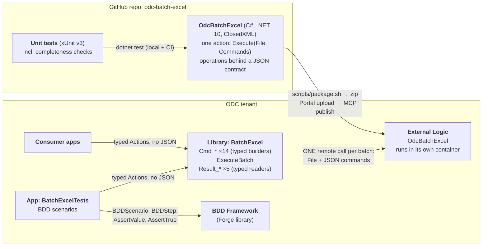
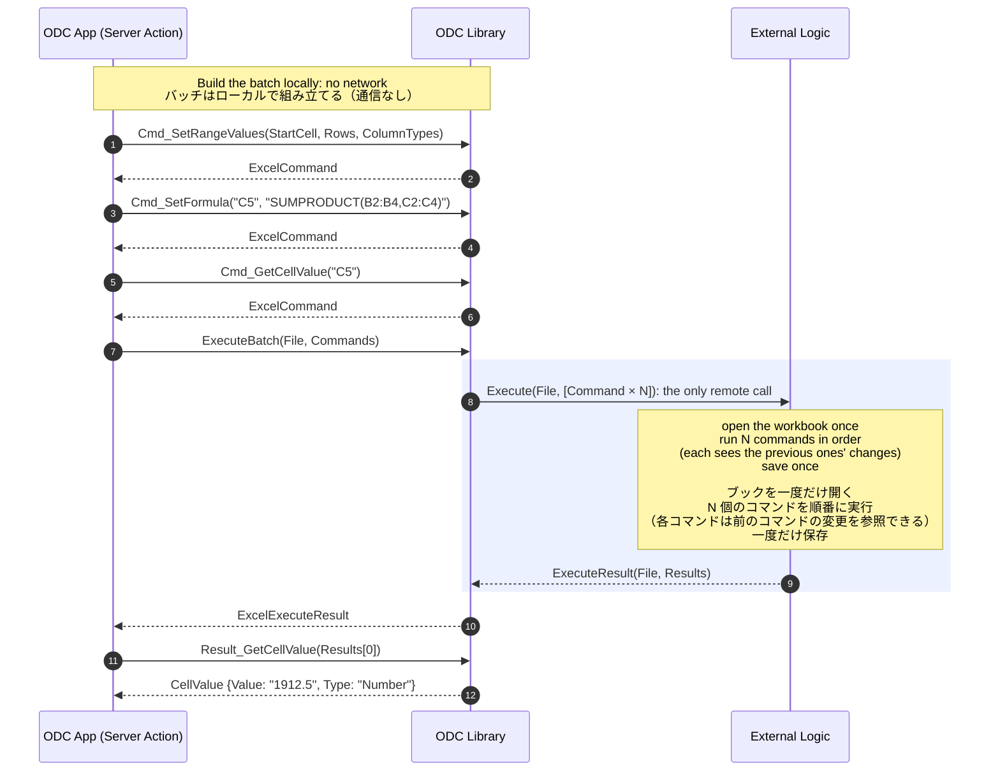

# OdcBatchExcel design

## Purpose

ODC apps call External Logic actions remotely, one call at a time. Editing an Excel file
operation by operation means one round trip, and one upload and download of the file, per
operation. OdcBatchExcel takes a workbook and a **list of commands**, runs them all in one call,
and returns the updated workbook along with anything the commands read.

## Architecture

| # | Part | Where | Status |
|---|---|---|---|
| 1 | External Logic library (C#, .NET 10, ClosedXML) | `src/OdcBatchExcel/` | Built |
| 2 | Unit tests (xUnit v3) | `tests/OdcBatchExcel.Tests/` | Built |
| 3 | ODC Library `BatchExcel`: one Action per operation that builds a command, plus `ExecuteBatch` | ODC tenant | Built; see [ODC Library](#part-3-odc-library-batchexcel) |
| 4 | ODC test app `BatchExcelTests` using BDDFramework | ODC tenant | Built; see [BDD test app](#part-4-bdd-test-app-batchexceltests) |

How the parts connect:



The ODC Library is compiled into each consuming app, so building commands with `Cmd_*` costs no
network round trip. Only `ExecuteBatch` crosses to the External Logic, once per batch:



The Excel library is [ClosedXML](https://github.com/ClosedXML/ClosedXML) (MIT license). It reads
and writes .xlsx, calculates formulas, and is built on Microsoft's OpenXML SDK. The packaged zip is
about 3 MB.

## Contract

The library exposes a single action. It must stay stable: renaming an action or changing a
signature breaks the apps that use it.

```
Execute(File: Binary Data, Commands: List of Command) -> Result: ExecuteResult

Command        { Operation: Text, Arguments: Text }                  // Arguments is a JSON object
ExecuteResult  { File: Binary Data, Results: List of CommandResult }
CommandResult  { CommandIndex: Integer, Operation: Text, Value: Text } // Value is a JSON object
```

- **Input file:** if `File` is empty, Execute starts from a new workbook with one sheet,
  `Sheet1`. Otherwise `File` must be an .xlsx workbook.
- **Order:** commands run in list order on one in-memory workbook. Each command sees the
  changes made by the commands before it, so a batch can write values and formulas and then
  read the calculated results.
- **Operation names** are case-insensitive. Results always use the canonical name.
- **Reads:** each read command adds one `CommandResult`, in command order. `CommandIndex` is
  the command's 1-based position. Write commands add no results.
- **Size:** the response must fit ODC's 5.5 MB limit. See [Limits](#limits).
- **All or nothing:** if any command fails, the whole action fails and no file is returned.
  The error message starts with the command's position and the operation as it was given, e.g.
  `Command #3 (SetCellValue): Value '1,5' is not a valid Number. ...`.
  In an ODC app the message arrives with the .NET exception type in front
  (`System.InvalidOperationException: Command #3 (SetCellValue): ...`), because ODC formats
  External Logic exceptions that way. Look for `Command #n (Operation):` anywhere in the message,
  not only at its start.
- **Recalculation:** the returned file asks Excel to recalculate fully when it opens
  (`fullCalcOnLoad`). See [Known limitations](#known-limitations).

The ODC contract is generic on purpose. A new operation only needs a new name and its own
JSON arguments, so the External Logic signature never changes.

## Operations

Every operation except `GetSheetNames` takes an optional `Sheet`, the worksheet name
(case-insensitive). If it's empty or left out, the operation uses the first worksheet.

### Writes

| Operation | Arguments (**bold** = required) | Notes |
|---|---|---|
| `SetCellValue` | **`Cell`**, **`Value`**, `ValueType` | `Cell` is A1-style (`B2`). `ValueType` is `Text` (default), `Number`, `Boolean` or `DateTime`. |
| `SetFormula` | **`Cell`**, **`Formula`** | A1-style formula. The leading `=` is optional. |
| `SetRangeValues` | **`StartCell`**, **`Rows`**, `ColumnTypes` | `Rows` is an array of arrays of strings. Without `ColumnTypes`, all values are text and rows may have different lengths. With it, every row must have exactly one value per column type. |
| `InsertRows` | **`Row`**, `Count` (1) | Inserts above `Row`. Data and formula references below move down. |
| `DeleteRows` | **`Row`**, `Count` (1) | Data below moves up. |
| `InsertColumns` | **`Column`**, `Count` (1) | `Column` is a letter (`C`). Inserts to the left of it. |
| `DeleteColumns` | **`Column`**, `Count` (1) | |
| `SetColumnWidth` | **`Columns`**, **`Width`** | `Columns` is `B` or `B:D`. `Width` is in Excel character units, more than 0 and at most 255. |
| `AutoFitColumns` | `Columns` | Left empty, it fits every used column. |

**Value conversion** (used by `SetCellValue` and `SetRangeValues`):
- **Empty string:** always clears the cell.
- **Number:** uses the invariant format (`1234.5`, `-1e3`). `NaN` and infinities are rejected.
- **Boolean:** `true` or `false`, case-insensitive.
- **DateTime:** ISO 8601 (`2026-11-07` or `2026-11-07T09:30:00`). A value with an offset or `Z`
  is converted to UTC. One without is stored as given. Excel has no time zones.

A header row and typed data rows need two `SetRangeValues` commands, one for the header (text)
and one for the data with `ColumnTypes`, because `ColumnTypes` applies to every row.

### Reads

All values in results are strings. Numbers use the invariant culture, dates are
`yyyy-MM-ddTHH:mm:ss` (fractional seconds only when present) and booleans are `true`/`false`.
A formula cell returns its calculated value.

| Operation | Arguments | Result `Value` |
|---|---|---|
| `GetCellValue` | **`Cell`** | `{"Value":"42","Type":"Number"}`. `Type` is one of `Blank`, `Text`, `Number`, `Boolean`, `DateTime`, `TimeSpan` or `Error`. For errors, `Value` is the Excel error code, e.g. `#DIV/0!`. |
| `GetRangeValues` | **`Range`**, `RowFormat` | `{"Rows":[["a","1"],["b","2"]]}`. `Range` is `A1:D20` or a single cell. Whole-column ranges like `A:A` aren't accepted. At most 1,000,000 cells. `RowFormat` is `Arrays` (default) or `Objects`, which wraps each row: `{"Rows":[{"Values":["a","1"]},...]}`. ODC has no list-of-lists type, so ODC apps use `Objects`. |
| `GetUsedRange` | — | `{"Address":"A1:D20","FirstRow":1,"FirstColumn":1,"RowCount":20,"ColumnCount":4}`. On an empty sheet, `Address` is `""` and the numbers are `0`. Only cells with content count, not formatting alone. |
| `GetColumnWidth` | **`Column`** | `{"Width":8.43}`, in Excel character units. `Column` is a single letter. Use it to check `SetColumnWidth` and `AutoFitColumns`. |
| `GetSheetNames` | none: `{}` | `{"Names":["Sheet1","Data"]}`, in workbook order. |

## Argument rules

Arguments are parsed strictly, so a mistake in the calling app fails loudly instead of being
silently ignored:

- `Arguments` must be a JSON object. Even an operation without arguments needs `{}`.
- Property names are case-insensitive.
- These are all errors, each with a message that names the property:
  - an unknown property, including one that belongs to a different operation
  - a missing required property
  - `null` in a property
  - a value of the wrong JSON type (e.g. `"Count":"2"`)
- After parsing, values are checked: addresses must be valid, `Row`/`Count` ≥ 1, everything
  must fit on the sheet (1,048,576 rows, columns up to `XFD`), and `ValueType` must be a known
  type.
- `SetRangeValues` converts every value before it writes anything, so a bad value leaves the
  sheet unchanged.

## Limits

- **ODC External Logic:** payloads up to 5.5 MB in each direction (the file is sent both ways),
  95 seconds per call and 1 GB of memory. Split very large workbooks or reads across calls.
- **Response size:** `Execute` keeps its response under 5.5 MB (`ResponseBudget`), so an
  oversized batch fails with a message that says what to split, not a generic ODC error.
  - **What is counted:** the estimate assumes ODC sends the response as JSON with Binary Data
    as Base64, so the file counts as 4/3 of its size. Each read result counts as its UTF-8 bytes
    plus JSON escaping and a small allowance for field names.
  - **When it fails:**
    - at the read whose result alone is over the limit (`The result is about ... Read a smaller range.`)
    - at the read that takes all results so far over it (`The read results so far are about ...`)
    - or, after the last command, when the file plus all results are over it (`The response would be about ...`)
  - **Basis:** in the maintainer's experience, ODC and External Logic exchange data as JSON,
    and .NET JSON serializers encode `byte[]` as Base64. The exact encoding and how ODC measures
    the limit are not documented, so if a real response is rejected below the estimate, or accepted
    above it, change `ResponseBudget.DefaultMaxBytes`.
- **Reads:** `GetRangeValues` refuses ranges of more than 1,000,000 cells before reading them.
  This guards memory only. The response-size check above is what bounds the result.
- **Result text:** result JSON keeps non-ASCII text as UTF-8 (`日本語`, not `日...`), so
  it counts at its real size.

## Known limitations

These come from ClosedXML. The first three are pinned by tests, so a ClosedXML upgrade that
changes them is noticed.

- **Deleted references:** when a row or column that a formula references is deleted, Excel
  shows `#REF!`, but ClosedXML points the reference at the neighboring row/column instead
  (`DeleteRows_ReferenceToADeletedRow_MovesToTheRowAbove_UnlikeExcel`).
- **Unsupported formulas:** ClosedXML can't calculate every Excel feature, e.g. the range
  intersection operator (`SUM(A1:A2 B1:B2)`). Writing such a formula works, but reading its value
  fails with `Could not calculate the formula in A1: ...`. Excel calculates it when the file is
  opened.
- **No cached formula values:** saved formulas don't include their calculated values. Excel
  recalculates on open (`fullCalcOnLoad`). Tools that read cached values without calculating,
  such as file previews or pandas/openpyxl in values-only mode, see those cells as empty.
- **AutoFit:** `AutoFitColumns` measures text with fonts available to ClosedXML. Widths in the
  ODC Linux container may differ slightly from local results. Check it when trying the library in
  an app.
- **File format:** only .xlsx. Legacy .xls files are not supported.

## Code layout

```
src/OdcBatchExcel/
  IOdcBatchExcel.cs              [OSInterface] contract: the Execute action
  OdcBatchExcel.cs               Execute: open/create the workbook, run each command, save
  ResponseBudget.cs              Keeps the response (file + read results) under ODC's 5.5 MB limit
  Command.cs, ExecuteResult.cs,
  CommandResult.cs               [OSStructure] types
  Commands/
    CommandRunner.cs             Operation catalog (name, argument record, handler) and dispatch
    CommandRunner.Cells.cs       SetCellValue, SetFormula, SetRangeValues
    CommandRunner.RowsColumns.cs InsertRows, DeleteRows, InsertColumns, DeleteColumns,
                                 SetColumnWidth, AutoFitColumns
    CommandRunner.Reads.cs       GetCellValue, GetRangeValues, GetUsedRange, GetColumnWidth,
                                 GetSheetNames
    Arguments.cs                 One record per operation's arguments, plus the read result records
    CommandArgs.cs               Strict JSON parsing and shared validation (sheets, addresses, values)
    CommandArgumentException.cs  Thrown for bad arguments; Execute wraps it with the command index
tests/OdcBatchExcel.Tests/
  ContractTests.cs               The ODC-facing contract (names, signature, structure fields)
  ExecuteTests.cs                Behavior of every operation, batching and general errors
  ArgumentValidationTests.cs     Valid/invalid argument tables for every operation, plus completeness checks
  ResponseLimitTests.cs          The 5.5 MB response limit: single reads, accumulated reads, file + results
  Batch.cs                       Test helpers
```

Each operation is a private static method that parses its arguments with
`CommandArgs.Parse<TArgs>`, validates them, and changes or reads the workbook. It returns `null`
for a write or the result JSON for a read. The catalog and the JSON options are immutable, which
keeps the library stateless as ODC requires.

### Adding an operation

1. Add an argument record in `Commands/Arguments.cs`. Mark required properties `required` and
   make optional ones nullable or give them a default. For a read, also add a result record.
2. Write the private method in the right `CommandRunner.*.cs` file, and add it to the catalog in
   `CommandRunner.cs` with its argument record type.
3. Add rows to `ArgumentValidationTests`: minimal and full valid arguments, a missing-property
   case for each required property, and an unknown-property case. The completeness tests fail
   until these exist. Add behavior tests to `ExecuteTests`.
4. Update the operation tables in this document. In ODC, add the matching command Action to the
   ODC Library (part 3).

The `Execute` signature does not change, so apps that already use the library keep working.

## Part 3: ODC Library `BatchExcel`

A LowCodeLibrary in the ODC tenant, built with Mentor. It hides the JSON from app developers.
Apps reference only BatchExcel, never the External Logic directly.

- **Structures (public):**
  - `ExcelCommand { Operation, Arguments }`
  - `ExcelResult { CommandIndex, Operation, Value }`
  - `ExcelExecuteResult { File, Results }`
  - `CellValue { Value, Type }`
  - `RangeRow { Values: Text List }`
  - `UsedRange { Address, FirstRow, FirstColumn, RowCount, ColumnCount }`
  - Private structures hold each operation's JSON argument shape.
- **Command builders** are functions, so an app can write
  `ListAppend(Commands, Cmd_SetCellValue("", "B2", "42", "Number"))`. There is one per operation:
  - `Cmd_SetCellValue`, `Cmd_SetFormula`, `Cmd_SetRangeValues`
  - `Cmd_InsertRows`, `Cmd_DeleteRows`, `Cmd_InsertColumns`, `Cmd_DeleteColumns`
  - `Cmd_SetColumnWidth`, `Cmd_AutoFitColumns`
  - `Cmd_GetCellValue`, `Cmd_GetRangeValues`, `Cmd_GetUsedRange`, `Cmd_GetColumnWidth`, `Cmd_GetSheetNames`
- **How the builders make their JSON:**
  - Each fills its argument structure and calls `JSONSerialize` with default values shown.
    An empty `Sheet`, `ValueType` or `Columns` is sent as `""`, which means "not given".
  - The `Count` inputs default to 1.
  - `Cmd_SetRangeValues` builds its `Rows` array of arrays as text, because ODC has no list-of-lists
    type. It leaves out `ColumnTypes` when the list is empty.
  - `Cmd_GetRangeValues` always sends `RowFormat:"Objects"`.
- **`ExecuteBatch(File, Commands)`** calls the External Logic `Execute` and maps the structures. It has
  no exception handler, so errors reach the app unchanged.
  - It isn't called `Execute`: a library action with that name clashes with the External Logic's
    `Execute`, and ODC renames it to `Execute2`.
- **Read helpers** are functions that take an `ExcelResult`, check its `Operation` and deserialize its `Value`:
  - `Result_GetCellValue`
  - `Result_GetRangeValues` (a list of `RangeRow`)
  - `Result_GetUsedRange`
  - `Result_GetColumnWidth` (Decimal)
  - `Result_GetSheetNames` (Text List)
- **Limitation:** a mismatched result raises `BatchExcelResultException`. ODC user exceptions can't be
  public, so apps catch it as a general exception.

When you add an operation, add its `Cmd_` builder (and a `Result_` helper for a read), then
release a new library version.

## Part 4: BDD test app `BatchExcelTests`

A Reactive Web App based on `Template_BDD Framework`. Its `BatchExcel_Suite` screen hosts one
block per scenario. In each block:
- the When step calls a `Run_*` server action, which builds the commands with BatchExcel, calls
  `ExecuteBatch` and returns typed values;
- the Then step asserts the results with `AssertValue` and `AssertTrue`.

BDD Framework checks the `AuthToken` URL parameter against a secret in the app's configuration in
the ODC Portal, so set that secret before you open the suite.

| Scenario | Checks |
|---|---|
| CellValueTypes | Text, Number, Boolean and DateTime values and types read back |
| Formula | `SUM(A1:A2)` is calculated in the same batch |
| RangeValues | A text header plus typed rows (`SetRangeValues`) read back with `GetRangeValues` |
| RowsAndColumns | Inserts and deletes move data, and `GetUsedRange` follows |
| SheetNames | An empty file starts with `Sheet1` |
| ColumnWidth | `SetColumnWidth` is read back by `GetColumnWidth` |
| AutoFit | AutoFit in the ODC container makes the column more than twice its default width |
| FailingBatch | The error names `Command #2 (SetCellValue)` and the bad value |
| ResponseLimit | 200 × 32,000-character formula results fail with `The result is about ...` |
| RoundTrip | A returned file passed to a second call keeps its values |
